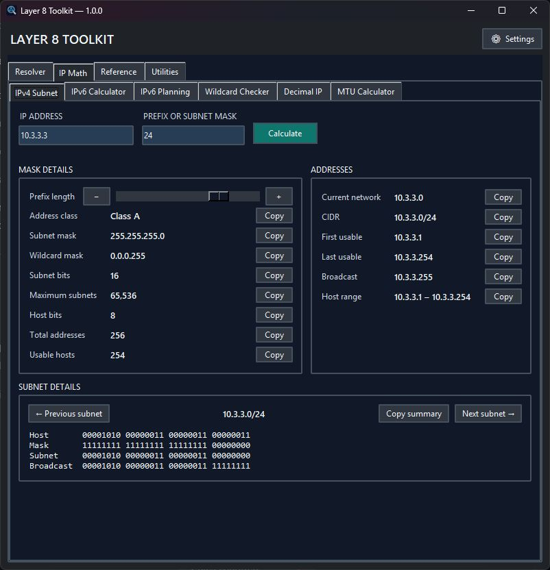

# Layer 8 Toolkit

Version 1.1.2 — a portable Windows toolkit for network engineers.



Download the one-file Windows application from the [latest release](https://github.com/Anonymous-cheese/Layer-8-Toolkit/releases/latest). The EXE includes its required libraries and reference data; no Python installation is needed. It is not code-signed and does not auto-update.

## What's included

- **Resolver:** paste or load up to five switch MAC tables and two router ARP tables, correlate MACs to IPs, inspect an input report, search and sort results, and export visible rows to CSV or filterable Excel. MAC-only Excel exports remain sortable and filterable.
- **IP tools:** IPv4 and IPv6 subnet calculators, IPv6 subnet planning, an IPv4 Site Planner for repeated VLAN layouts, wildcard-mask checker, and decimal/hex/binary IPv4 conversion.
- **DHCP and network references:** common DHCP option explanations and encoders, including Cisco WLC/custom Option 43 and classless-route Option 121; an offline searchable IANA port snapshot; DNS record builder; and MTU/overhead calculator.
- **Utilities:** multiline MAC formatter with offline OUI lookup, Cisco Type 7 decrypter, 12-hour/24-hour clock converter and reference table, and Wi-Fi join QR codes with PNG/SVG export, image/payload copy, print sizing, and optional live preview.
- **Workspace settings:** dark/light palettes with editable hex colors, startup tab, and persistent tab order, visibility, and custom groups. Settings open inside the main window.

All calculations and reference searches work offline. Updating the optional OUI database is an explicit network action. The bundled port registry is a dated snapshot; its provenance is in [data/SOURCE.md](data/SOURCE.md).

## Getting started

1. Download and run the EXE from [Releases](https://github.com/Anonymous-cheese/Layer-8-Toolkit/releases).
2. For switchport correlation, open **Resolver** and paste `show mac address-table` output into switch tabs. Optionally paste `show ip arp` output into either router tab. Click **Lookup**.
3. Search, filter, or click a result heading to sort. **Export** saves the visible results to CSV or Excel.
4. Choose a network tool from the top tab strip. Use **Settings → Tabs** to reorder, hide, or group tabs, and **Settings → General** to choose the startup tab.

Resolver options such as MAC formatting, port-channel/CPU exclusion, and IP-match filtering are in Settings. Raw switch/router output is saved only when you explicitly save a session. On first run, Toolkit can copy preferences from an existing SwitchPort Resolver installation; afterward the applications keep separate settings and logs. See the [team guide](docs/TEAM_GUIDE.md) for data-handling guidance.

### Site Planner

Under **IP Math → Site Planner**, enter a parent IPv4 CIDR and one `VLAN, name, /prefix` line per VLAN. Leave the site block on **Auto** for the smallest fit, or enter a shorter prefix such as `/21` to reserve growth space. Set the number of sites to generate; the planner shows maximum capacity, each site's summary CIDR, VLAN allocations, and exact unallocated CIDRs. You can copy a selected CIDR, copy the complete plan, or export CSV. It calculates locally and never changes network configuration.

Click the **?** in Site Planner for an in-page example and a quick explanation of each input.

### 24-Hour Clock

Under **Utilities → 24-Hour Clock**, enter a time such as `2:30 PM`, `14:30`, or `1430` to see both clock formats. Inputs without AM/PM are interpreted as 24-hour time. The table lists every whole hour from `00:00` through `23:00`. This changes notation only; it does not convert dates or time zones.

## Important notes

- Generated DHCP, DNS, and MTU values are aids for review, not configuration pushed to devices. Verify vendor-specific DHCP formats, DNS zone syntax, tunnel overhead, and client behavior before deployment.
- Cisco Type 7 is reversible. Revealed or copied values are sensitive credentials.
- Wi-Fi QR images and payloads expose the network password to anyone who can scan or read them. WPA3/mixed choices use the QR format's compatibility `T:WPA` token, which does not enforce a security mode; test with the intended device. WEP is legacy and insecure. The app does not save Wi-Fi profiles or passwords.
- A port registry assignment does not prove that observed traffic uses that service. The MTU calculator does not measure path MTU or include optional headers or device-specific limits.

Standards and source details are documented in the [deployment guide](docs/DEPLOYMENT.md), [team guide](docs/TEAM_GUIDE.md), and [third-party notices](THIRD_PARTY_NOTICES.txt).

## Build from source

On Windows with Python 3.10+:

```powershell
python -m pip install -r requirements-build.txt
python -m pip install pyinstaller
powershell -ExecutionPolicy Bypass -File scripts\build_release.ps1
```

The build script runs tests and a compile check, then creates `dist/Layer8Toolkit.exe`. GitHub keeps a separate copy of this filename with each release. See the [deployment guide](docs/DEPLOYMENT.md) for validation and rollout details.

## License

This project is licensed under the MIT License. Bundled third-party components have their own terms; see [THIRD_PARTY_NOTICES.txt](THIRD_PARTY_NOTICES.txt).
